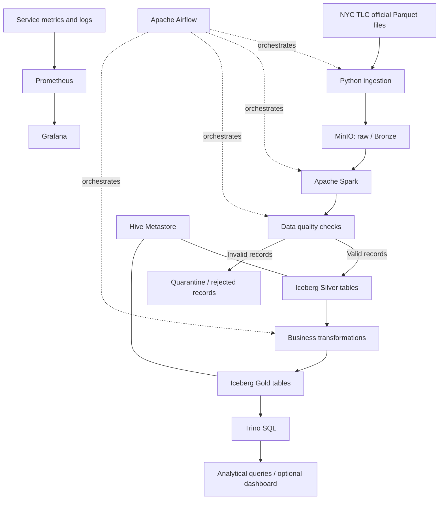

# Project Plan — AWS-Inspired Transportation Data Lakehouse

> **Project:** AWS-Inspired Transportation Data Lakehouse
> **Repository name:** `aws-inspired-transportation-lakehouse`
> **Project type:** Local cloud-like data lakehouse (not an actual AWS deployment)
> **Dataset:** NYC TLC Yellow Taxi Trip Records
> **Primary goal:** Demonstrate production-style batch data engineering, lakehouse design, orchestration, data quality, observability, testing, and documentation.

---

## 1. Project objective

Build a reproducible local data lakehouse that uses open-source technologies to model selected AWS data-platform capabilities.

The platform will ingest public NYC TLC Yellow Taxi trip data, store immutable source files in S3-compatible object storage, process data with Apache Spark, persist curated tables in Apache Iceberg, expose them through Trino SQL, orchestrate workflows with Apache Airflow, and monitor the platform with Prometheus and Grafana.

The project must demonstrate engineering practices, not just a successful one-time ETL run:

- Repeatable and idempotent ingestion.
- Bronze / Silver / Gold data layers.
- Explicit schema handling and data contracts.
- Data quality checks and rejected-record handling.
- Incremental processing by source month.
- Workflow retries, logging, and failure visibility.
- Automated tests at unit, integration, and end-to-end levels.
- Operational documentation and reproducible local setup.

**Important representation rule:** describe this as an *AWS-inspired local implementation*. Do not claim hands-on AWS service experience because this version does not deploy AWS resources.

## 2. AWS concept mapping

| AWS concept/service | Local implementation | Responsibility |
|---|---|---|
| Amazon S3 | MinIO | S3-compatible object storage |
| AWS Glue ETL / Amazon EMR | Apache Spark | Distributed-style data processing; run in local mode |
| AWS Glue Data Catalog | Hive Metastore | Shared table metadata/catalog |
| Amazon Athena | Trino | SQL query engine over Iceberg tables |
| Amazon MWAA | Apache Airflow | Workflow orchestration |
| Amazon CloudWatch | Prometheus + Grafana + container logs | Metrics and operational dashboards |

This is a functional/conceptual mapping, not feature parity. Hive Metastore is not AWS Glue Data Catalog; Trino is not Athena; local Spark is not a managed EMR cluster; Airflow is not MWAA; and Prometheus/Grafana are not CloudWatch.

### Selected architecture decisions

- Use **Hive Metastore** as the initial shared catalog because Spark and Trino have mature interoperability with it. Keep the catalog behind configuration so a future Project Nessie experiment can be added without redesigning the whole pipeline.
- Use **Apache Iceberg** for Silver and Gold tables.
- Use **MinIO** for raw Parquet files and Iceberg warehouse data.
- Use **Spark local mode** for transformations. Do not create a multi-node Spark cluster for this laptop-oriented project.
- Use **Trino** to query Iceberg tables.
- Use **Airflow** to orchestrate ingestion, transformation, quality checks, and publish steps.
- Use **Prometheus + Grafana** for a focused operational dashboard. Prefer a small set of reliable metrics over a complicated monitoring stack.

## 3. Dataset and scope

### Primary source

**NYC TLC Yellow Taxi Trip Record Data**
Official source: https://www.nyc.gov/site/tlc/about/tlc-trip-record-data.page

Use the official TLC published Parquet files. Do not scrape unofficial mirrors.

### Initial data scope

Start small and configurable:

- Taxi type: Yellow Taxi only.
- Initial period: two consecutive months, selected through configuration.
- Default example period: January and February 2024, but verify the official source files exist before downloading.
- Add the TLC Taxi Zone Lookup CSV as a small reference dataset if needed.
- Do not download the entire historical dataset during initial development.

The project must allow users to change the selected months without changing application code.

### Expected source fields

The implementation must inspect the actual Parquet schema before finalizing transformations. Common Yellow Taxi fields include:

- `VendorID`
- `tpep_pickup_datetime`
- `tpep_dropoff_datetime`
- `passenger_count`
- `trip_distance`
- `RatecodeID`
- `store_and_fwd_flag`
- `PULocationID`
- `DOLocationID`
- `payment_type`
- `fare_amount`
- `extra`
- `mta_tax`
- `tip_amount`
- `tolls_amount`
- `improvement_surcharge`
- `total_amount`
- `congestion_surcharge`
- `Airport_fee` / `airport_fee` where present, depending on source schema and period

Treat this list as a guide, not a guaranteed schema. Handle optional and renamed fields explicitly. Preserve the original raw Parquet file unchanged.

### Data use and privacy

- Use public data from the official TLC source.
- Include source attribution and a link to the official data page.
- Review the source's current terms and data documentation before publishing.
- Do not add personal data or attempt to re-identify individuals.
- Document that public trip records can contain unusual or invalid operational values.

## 4. Target architecture



### Data layers

**Bronze — raw landing**

- Store downloaded source Parquet files unchanged in MinIO.
- Use predictable object keys, for example:
  `raw/yellow_taxi/year=2024/month=01/yellow_tripdata_2024-01.parquet`
- Store ingestion metadata separately where useful: source URL, retrieval timestamp, file size, checksum, source month, and pipeline run ID.
- Re-running ingestion must not create uncontrolled duplicate objects.

**Silver — cleaned and standardized**

- Read Bronze Parquet with Spark.
- Normalize column names and types into a documented canonical schema.
- Standardize timestamps and numeric types.
- Add ingestion metadata such as `source_year`, `source_month`, `ingested_at`, and `pipeline_run_id`.
- Apply data quality rules.
- Write valid records to an Iceberg Silver table.
- Write invalid records and rejection reasons to a quarantine location/table.
- Make processing idempotent by source month. Reprocessing a month must replace or safely merge that month, not append duplicates.

**Gold — analytics-ready**

Create a small set of useful aggregate tables, such as:

1. `gold.monthly_trip_summary`
   - month
   - trip_count
   - total_revenue
   - average_trip_distance
   - average_fare
   - average_tip
2. `gold.hourly_trip_demand`
   - pickup_date
   - pickup_hour
   - pickup_location_id
   - trip_count
   - average_trip_distance
3. `gold.pickup_zone_summary` (only if the Taxi Zone Lookup is successfully integrated)
   - pickup_location_id
   - pickup_zone
   - borough
   - trip_count
   - total_revenue

Use business definitions that are documented and consistent. For example, state whether revenue uses `total_amount` and how invalid/negative values are handled.

## 5. Technology stack

### Required

| Component | Technology | Purpose |
|---|---|---|
| Language | Python | Ingestion, utilities, tests |
| Environment | `uv` + virtual environment | Python dependency management |
| Containers | Docker Compose | Reproducible local services |
| Object storage | MinIO | S3-compatible storage |
| Processing | Apache Spark (local mode) | Data transformation |
| Table format | Apache Iceberg | ACID lakehouse tables |
| Catalog | Hive Metastore + PostgreSQL | Shared metadata catalog |
| Query | Trino | SQL analytics |
| Orchestration | Apache Airflow | Scheduled workflows |
| Monitoring | Prometheus + Grafana | Metrics and dashboards |
| Tests | pytest | Unit and integration tests |
| Quality | PySpark assertions + SQL checks | Data quality rules |
| CI | GitHub Actions | Lint and test automation |

### Optional, only after the core platform works

- Metabase or Superset for a simple analytics dashboard.
- Project Nessie as an alternative catalog experiment.
- OpenLineage/Marquez for lineage.
- A small AWS deployment branch using real AWS services.

Do not add optional components before the core end-to-end pipeline passes.

## 6. Repository structure

```text
aws-inspired-transportation-lakehouse/
├── .github/
│   └── workflows/
│       └── ci.yml
├── airflow/
│   ├── dags/
│   └── plugins/
├── config/
│   ├── app.yaml
│   └── logging.yaml
├── docker/
│   ├── airflow/
│   ├── spark/
│   ├── trino/
│   └── prometheus/
├── docs/
│   ├── architecture.md
│   ├── data-dictionary.md
│   ├── data-quality.md
│   ├── operations-runbook.md
│   ├── decisions/
│   └── screenshots/
├── infra/
│   ├── compose/
│   └── prometheus/
├── scripts/
│   ├── bootstrap.sh
│   ├── download_sample_data.py
│   └── smoke_test.sh
├── src/
│   └── lakehouse/
│       ├── ingestion/
│       ├── processing/
│       ├── quality/
│       ├── storage/
│       ├── config/
│       └── common/
├── sql/
│   ├── trino/
│   └── checks/
├── tests/
│   ├── unit/
│   ├── integration/
│   └── e2e/
├── monitoring/
│   └── grafana/
├── .env.example
├── .gitignore
├── docker-compose.yml
├── Makefile
├── pyproject.toml
├── README.md
└── PROJECT_PLAN.md
```

The implementation may adjust this structure if there is a clear engineering reason. Keep the project modular without creating unnecessary abstractions.

## 7. Implementation phases and checklists

Do not mark a task complete until its acceptance criteria are met and evidence is recorded.

### Phase 0 — Discovery, compatibility, and design

- [x] Confirm the development environment: Windows + WSL2 Ubuntu + Docker Desktop integration. (WSL2 confirmed; Docker Desktop ownership/integration cannot be distinguished from the available Docker server details.)
- [x] Check available CPU, memory, and disk space.
- [x] Check Docker Engine and Docker Compose versions.
- [x] Check Python and `uv` availability.
- [x] Verify official TLC source URL patterns and selected monthly Parquet files.
- [x] Inspect the real Parquet schema for every selected month.
- [x] Decide the canonical Silver schema and optional-column strategy (proposal; validate against implementation fixtures in Phase 4).
- [x] Create architecture diagram.
- [x] Record key decisions in `docs/decisions/`.

**Acceptance criteria**

- A documented, resource-aware architecture exists.
- Selected data files are verifiably available from the official source.
- The schema differences between selected files are understood.
- No application code or services have been built on unverified assumptions.

### Phase 1 — Repository and developer experience

- [x] Initialize Git repository and `.gitignore`. (The repository was already initialized; added ignore rules without creating a commit.)
- [x] Create `pyproject.toml` and `uv` virtual environment.
- [x] Add formatting/linting tools (Ruff).
- [x] Add pytest configuration.
- [x] Add `.env.example`; never commit real credentials.
- [x] Create Makefile commands for common tasks. (GNU Make is absent in the inspected host, so targets could not be invoked here.)
- [x] Add a concise initial README.
- [x] Add configuration validation.
- [x] Add structured logging conventions.

**Acceptance criteria**

- A new developer can follow documented setup steps.
- `uv sync`, lint, and unit-test commands work.
- Secrets and raw data are excluded from Git.
- Commands are documented and do not depend on a developer's private machine paths.

### Phase 2 — Local infrastructure

Start with a minimal Compose profile and add services only when needed.

- [x] MinIO object storage with persistent volume and health check. (Container reports healthy; the S3 smoke check successfully put and retrieved an object.)
- [x] PostgreSQL service for Hive Metastore metadata. (PostgreSQL health check passed.)
- [x] Hive Metastore service configured for Iceberg-compatible tables. (Schema initialized; Thrift health check passed; Spark connected.)
- [x] Trino service configured to use the shared catalog and MinIO. (Health check and Spark table read passed.)
- [x] Spark runtime configured for local mode and MinIO access. (Spark wrote and read an Iceberg table with Parquet data through MinIO.)
- [x] Airflow with a supported local executor/configuration and persistent metadata database. (Airflow 3.4.0 UI healthy; LocalExecutor DAG smoke run passed.)
- [x] Prometheus and Grafana in a separate monitoring profile. (Both health checks and HTTP endpoints passed independently.)
- [x] Add Docker health checks, named volumes, resource limits where practical, and restart policies. (Verified via healthy Compose services and named volume configuration.)
- [x] Use non-default development credentials through `.env`. (Compose requires ignored `.env` values; `.env.example` contains local-only values.)
- [x] Add startup, shutdown, and cleanup commands. (Documented in README and Makefile; Make invocation remains unverified because GNU Make is unavailable.)
- [x] Document exposed ports and local service URLs. (README and `docs/local-infrastructure.md`.)

**Acceptance criteria**

- [x] Services start using documented commands.
- [x] Health checks report healthy for required services.
- [x] MinIO can store and retrieve a test object.
- [x] Spark can read/write a small test Parquet object in MinIO. (The Iceberg smoke table explicitly uses Parquet format.)
- [x] Hive Metastore is reachable.
- [x] Trino can connect to the catalog and read Spark's table.
- [x] Airflow UI is reachable and can execute a simple DAG.
- [x] Monitoring services start independently.
- [x] No credentials are hard-coded in tracked files.

### Phase 3 — Data ingestion to Bronze

- [x] Implement configurable source-month selection. (`LAKEHOUSE_SOURCE_MONTHS`; repeatable `--month` override.)
- [x] Download only from the official TLC source. (URL is constructed against the official TLC CloudFront data host.)
- [x] Support retry with backoff for transient network failures. (Bounded exponential backoff for network errors and transient HTTP statuses.)
- [x] Stream downloads to disk or object storage; do not load large files fully into memory. (1 MiB chunks to a temporary file.)
- [x] Validate HTTP status, file size, and Parquet readability. (2xx response, non-empty body, Content-Length when provided, PyArrow footer/schema read.)
- [x] Compute SHA-256 checksum. (Incremental while streaming.)
- [x] Upload raw Parquet unchanged to MinIO. (S3 upload from the validated file; checksum verified on readback.)
- [x] Write an ingestion manifest containing source URL, month, timestamp, checksum, size, and run ID. (Adjacent JSON object.)
- [x] Implement idempotency: skip an identical object or replace it safely according to documented policy. (Same checksum/size/source URL skips; changed content atomically overwrites its month key, then updates the manifest.)
- [x] Log counts and timings. (Per-month input/upload/skip counts, download and upload durations, bytes, run ID, status, and object key.)
- [x] Add unit tests with tiny fixtures and mocked HTTP responses.

**Acceptance criteria**

- [x] A selected month is present in the expected Bronze object path. (January and February 2024 official source objects were landed.)
- [x] The object can be read back from MinIO. (Both returned readable Parquet and matched manifest size/checksum.)
- [x] Manifest metadata is present. (Verified required fields on both objects.)
- [x] Re-running ingestion does not create duplicate logical inputs. (Rerun reported both months skipped.)
- [x] Failed or incomplete downloads do not appear as successful ingestion. (Unit tests cover non-retryable 404, incomplete Content-Length, and invalid Parquet; all fail without publishing a local validated file.)

### Phase 4 — Silver processing with Spark and Iceberg

- [x] Configure Spark with Iceberg and MinIO dependencies. (Retained Spark 3.5.3/Iceberg 1.6.1; added Hadoop S3A 3.3.4 matching the image's Hadoop client.)
- [x] Read Bronze Parquet by source month. (S3A reads the two Bronze object paths.)
- [x] Inspect and normalize source schema. (Inspected both actual schemas and mapped 19 canonical fields.)
- [x] Handle optional fields and known naming differences. (Typed nulls for absent optional fields; aliases include `Airport_fee`/`airport_fee`.)
- [x] Cast fields into canonical types. (`try_cast` plus explicit malformed and non-integral reasons.)
- [x] Add lineage and ingestion metadata columns. (Source month/year/file/URL, manifest retrieval time and ingestion run ID, processing timestamp.)
- [x] Implement documented data quality rules. (Timestamp, ordering, numeric parsing, distance, passenger count, and location-code rules; negative monetary values retained with flags.)
- [x] Split valid and rejected records.
- [x] Store rejection reasons for invalid records. (String-array reason codes in quarantine Iceberg.)
- [x] Create Silver Iceberg table through Hive Metastore. (Separate valid and quarantine tables.)
- [x] Partition using a justified time-based partition strategy. (Partition by source month, the processing/replacement unit.)
- [x] Make monthly reprocessing idempotent. (Iceberg overwrite-by-filter on the source-month partition.)
- [x] Add schema and transformation unit tests. (Schema unit tests plus Spark fixture assertions of transform and quality behavior.)
- [x] Add integration test: Spark writes Iceberg and Trino can read it. (Spark processed real Bronze months; Trino queried both Silver tables.)

**Suggested initial quality rules**

- Pickup and dropoff timestamps must be parseable and non-null.
- Dropoff timestamp must not precede pickup timestamp.
- Trip distance must be non-negative.
- Passenger count must be non-negative when present.
- Location IDs must be within the documented expected domain when applicable.
- Monetary fields must be parseable; unusual negative values should be classified and handled by an explicit rule rather than silently discarded.
- Required canonical columns must exist after normalization.

Do not assume every negative amount or unusual value is invalid without documenting the domain rule. Preserve raw data and record rejection reasons.

**Acceptance criteria**

- [x] Silver Iceberg table is queryable through Trino.
- [x] Valid and rejected records are separately measurable. (January: 2,964,568 valid / 56 rejected; February: 3,007,519 valid / 7 rejected.)
- [x] Quality rules are tested. (Spark fixture covers missing/unparseable timestamps/numeric values, temporal order, negative distance/passenger count, out-of-range IDs, optional fields, and retained negative-money warning.)
- [x] Reprocessing a month does not multiply its rows. (Rerun counts matched the first run exactly.)
- [x] Schema handling works for all selected source months. (Both inspected 19-column source schemas processed successfully.)

### Phase 5 — Gold transformations and analytics

- [x] Define business questions and metric definitions in `docs/gold-metrics.md`.
- [x] Build `gold.monthly_trip_summary`.
- [x] Build `gold.hourly_trip_demand`.
- [x] Integrate the official TLC Taxi Zone Lookup and build `gold.pickup_zone_summary`.
- [x] Write transformations as maintainable Spark jobs with explicit grains and source-month replacement.
- [x] Add pre-publication reconciliation checks between Silver and Gold.
- [x] Add Trino SQL examples for key business questions under `sql/trino/`.
- [x] Document grain, dimensions, measures, and limitations in `docs/gold-metrics.md`.
- [x] Capture representative query results for README.

**Acceptance criteria**

- [x] Gold tables are queryable through Trino.
- [x] Aggregates reconcile to the documented Silver input scope.
- [x] Business metrics have clear definitions.
- [x] Queries return meaningful results for the selected months.

### Phase 6 — Airflow orchestration

- [x] Create a DAG with clear task boundaries.
- [x] Add tasks for source validation, ingestion, Bronze verification, Silver processing, quality checks, Gold processing, and final verification.
- [x] Parameterize source months as a validated Airflow `source_months` list.
- [x] Configure retries, retry delays, timeouts, and failure callbacks.
- [x] Use environment-based configuration and private task environment for MinIO credentials; no credentials are hard-coded in DAG code.
- [x] Make task retries safe through idempotent Bronze, Silver, and Gold processing.
- [x] Add task-level logging and Airflow run IDs.
- [x] Add a backfill/reprocessing procedure in `docs/operations-runbook.md`.
- [x] Add DAG import/structure validation and local end-to-end, retry, failure, and rerun checks.

**Acceptance criteria**

- [x] One DAG run processes the selected month(s) end to end.
- [x] A controlled task failure is visible and retry behavior works.
- [x] Re-running a completed month is safe.
- [x] Airflow logs make it possible to identify the failing stage.

### Phase 7 — Observability and operational readiness

- [x] Expose MinIO metrics to Prometheus.
- [x] Expose Airflow metrics through the supported StatsD-to-Prometheus exporter path.
- [x] Add HTTP/TCP service health probes and retain Compose container health checks.
- [x] Build Grafana panels for service health, DAG/task outcomes and duration, input/valid/rejected/Gold rows, last successful run, and MinIO storage usage.
- [x] Verify structured logs include run ID, source month, component, and status.
- [x] Add clear failure messages and operational restart/recovery steps.
- [x] Test MinIO restart and successful pipeline recovery/reprocessing.
- [x] Document metric definitions and known gaps.

**Acceptance criteria**

- [x] A user can identify whether the platform is healthy.
- [x] A failed pipeline stage can be traced from Airflow logs and run ID.
- [x] The dashboard displays real metrics, not fabricated sample values.
- [x] Restart/recovery steps are documented and tested.

### Phase 8 — Testing, CI, and performance checks

- [x] Unit tests for ingestion, config, schema normalization, and the Silver/quarantine reconciliation gate; Spark fixture tests cover classification rules.
- [x] Opt-in integration tests for MinIO, Spark, Iceberg, Hive Metastore, Trino, and Airflow DAG structure.
- [x] End-to-end test for a four-row fixture through Bronze, Silver, quarantine, Gold, and Trino.
- [x] Test empty and malformed input, missing optional fields, duplicate Bronze ingestion, and repeated Silver/Gold processing.
- [x] Test invalid-record quarantine and explicit reconciliation failure behavior.
- [x] Add GitHub Actions for locked dependency setup, Ruff lint/format, DAG syntax, and unit tests.
- [x] Keep service integration and E2E tests opt-in with controlled Compose startup/teardown.
- [x] Measure stage durations and record input/output/rejected row counts.
- [x] Document reproducible measurement commands, resource requirements, and performance limitations.

**Acceptance criteria**

- [x] CI-equivalent setup, lint, format, DAG syntax, and unit tests pass from a clean checkout copy.
- [x] Unit and four-row E2E tests do not download or require the full public dataset.
- [x] Integration tests verify real MinIO, Spark/Iceberg/Hive Metastore/Trino interoperability and Airflow DAG structure.
- [x] Recorded timings and row counts include reproducible commands and explicit local-environment limits.

### Phase 9 — Documentation and portfolio release

- [x] Write a professional README with problem statement, architecture, stack, setup, and demo.
- [x] Add architecture diagram and AWS-concept mapping.
- [x] Add data dictionary and data-quality documentation.
- [x] Add operational runbook and troubleshooting guide.
- [x] Add screenshots of Airflow, MinIO, Grafana, and Trino query results.
- [x] Add sample SQL queries and outputs.
- [x] Add a limitations section.
- [x] Add a cost statement: local version has no AWS infrastructure charges, but uses local compute/storage/electricity.
- [x] Verify no credentials, large raw data, private paths, or generated secrets are committed.
- [x] Create the versioned local release tag `v0.1.0` after all checks pass.

**Acceptance criteria**

- [x] A recruiter can understand the project in under two minutes from the README.
- [x] A developer can reproduce the demo from a clean environment using the docs.
- [x] Screenshots show actual running services and real pipeline outputs.
- [x] The README clearly states this is a local AWS-inspired implementation, not an AWS deployment.

## 8. Data quality and metric definitions

Keep business and technical rules explicit.

### Technical metrics

- Source files discovered/downloaded.
- Source bytes downloaded.
- Bronze objects written/skipped.
- Silver input, valid, and rejected row counts.
- Gold output row counts.
- Processing duration by stage.
- Pipeline success/failure.
- Retry count.
- Last successful processing timestamp.

### Business metrics

- Number of trips.
- Total reported trip revenue using a documented definition.
- Average trip distance.
- Average fare and tip.
- Trips by pickup hour.
- Trips by pickup zone, if zone reference data is available.

Do not present a metric without documenting its grain, filters, null treatment, and calculation.

## 9. Engineering standards

- Prefer small, testable modules and clear interfaces.
- Use type hints for Python public functions.
- Use structured logging.
- Keep configuration outside source code.
- Use environment variables for credentials and connection details.
- Include `.env.example`, never `.env`.
- Pin compatible dependency versions after testing them together.
- Do not blindly upgrade Spark, Iceberg, Hadoop AWS, Trino, Hive Metastore, and Airflow independently.
- Verify container images and dependencies against official compatibility documentation.
- Use local Spark mode; avoid unnecessary cluster services.
- Do not commit raw TLC Parquet files, database volumes, logs, or secrets.
- Do not claim production-scale performance from a laptop benchmark.
- Do not claim AWS experience based only on local equivalents.

## 10. Definition of done

The project is portfolio-ready only when:

- [ ] A clean setup can start required services.
- [ ] Official source data can be ingested into MinIO Bronze.
- [ ] Spark creates Silver and Gold Iceberg tables.
- [ ] Trino queries the Iceberg tables successfully.
- [ ] Airflow orchestrates the end-to-end flow.
- [ ] Quality checks and quarantine behavior work.
- [ ] Reprocessing is idempotent.
- [ ] Prometheus/Grafana show real operational metrics.
- [ ] Unit, integration, and end-to-end tests pass.
- [ ] CI passes.
- [x] README, diagrams, data dictionary, runbook, and screenshots are complete.
- [ ] Public repository contains no secrets or raw source data.
- [x] AWS-equivalent claims are accurately qualified as local/open-source equivalents.

## 11. Useful official references

- NYC TLC Trip Record Data: https://www.nyc.gov/site/tlc/about/tlc-trip-record-data.page
- MinIO documentation: https://min.io/docs/
- Apache Spark documentation: https://spark.apache.org/docs/latest/
- Apache Iceberg documentation: https://iceberg.apache.org/docs/latest/
- Apache Hive documentation: https://hive.apache.org/
- Trino documentation: https://trino.io/docs/current/
- Apache Airflow documentation: https://airflow.apache.org/docs/
- Prometheus documentation: https://prometheus.io/docs/
- Grafana documentation: https://grafana.com/docs/
- Docker Compose documentation: https://docs.docker.com/compose/
