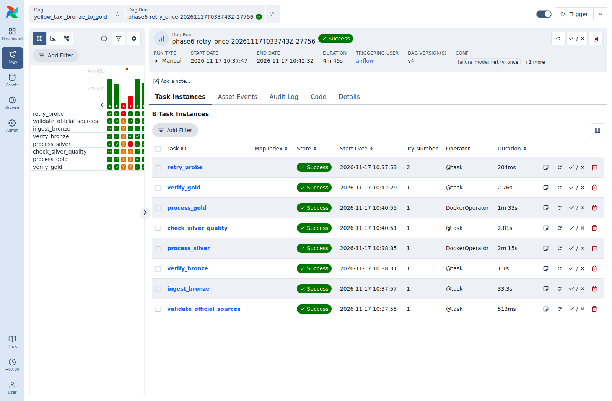
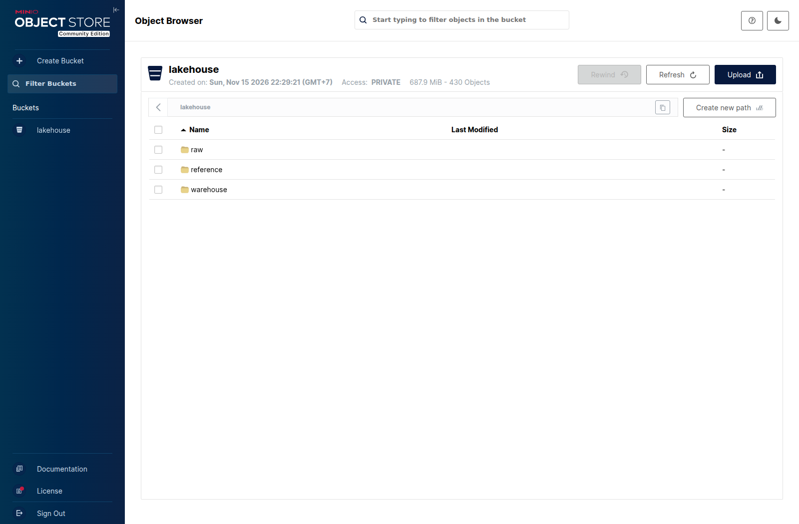
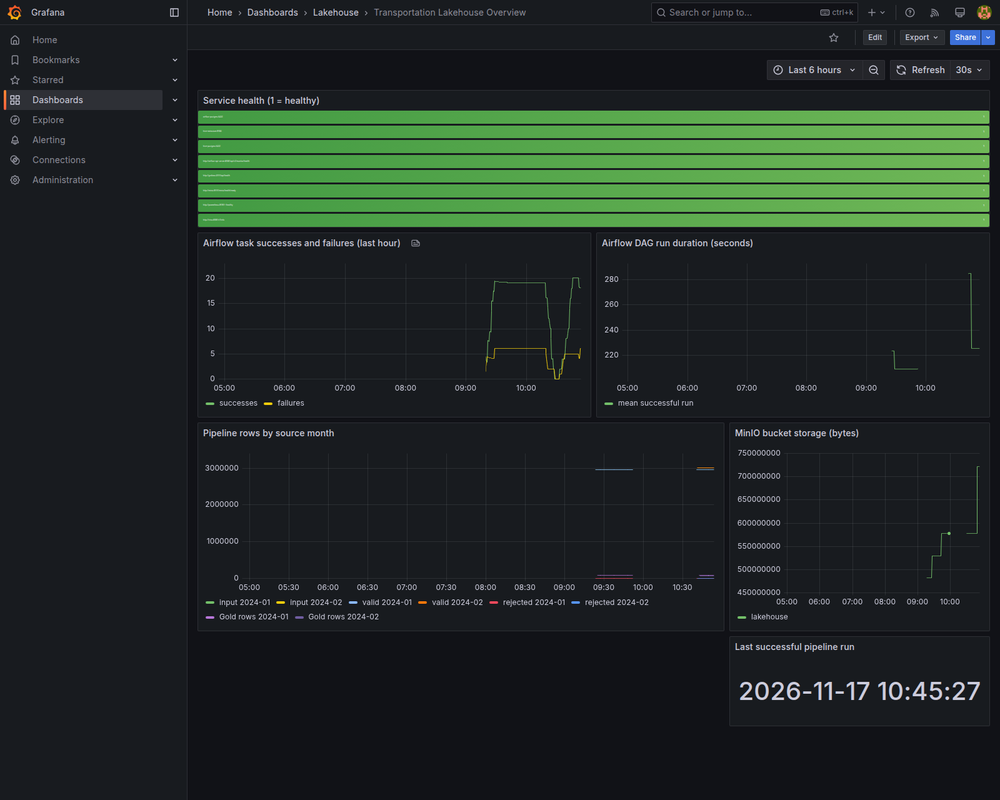
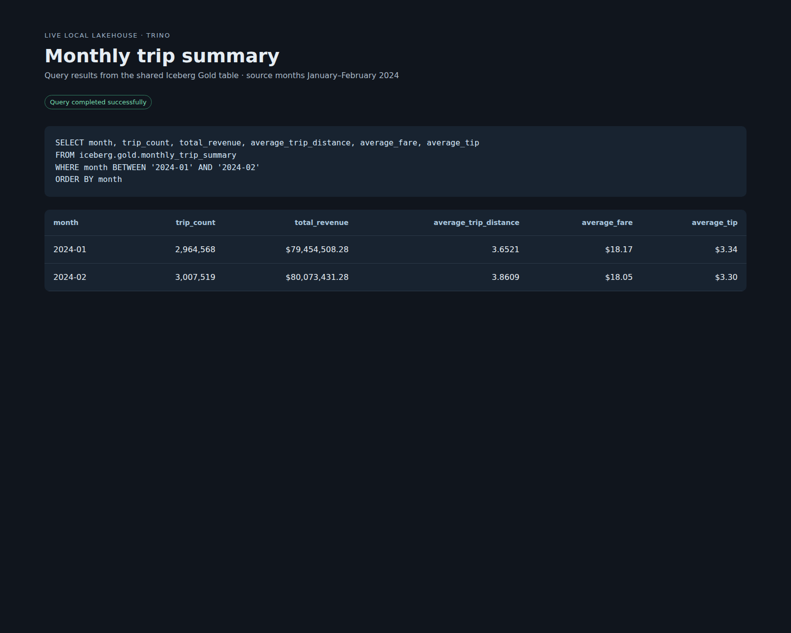

# AWS-Inspired Transportation Data Lakehouse

A reproducible local batch lakehouse for public [NYC TLC Yellow Taxi trip records](https://www.nyc.gov/site/tlc/about/tlc-trip-record-data.page). It demonstrates checksum-verified Bronze ingestion, quality-checked Silver data with quarantine, reconciled Gold aggregates, orchestration, and operational monitoring using open-source services.

> **Scope:** This is an AWS-inspired local implementation. It does not deploy AWS resources and is not evidence of hands-on AWS service experience.

## At a glance

- **Problem:** Make monthly trip files safe to ingest repeatedly, inspect when records fail quality rules, and query through documented business metrics.
- **Data path:** TLC Parquet → Python / MinIO Bronze → Spark / Iceberg Silver and quarantine → Spark / Iceberg Gold → Trino.
- **Operations:** Airflow orchestrates the stages; Prometheus and Grafana show service health and pipeline metrics.
- **Engineering:** Python 3.12 with `uv`, Docker Compose, pytest, Ruff, and GitHub Actions.

The full [architecture and data flow](docs/architecture.md) includes the diagram, validated component versions, and [AWS-concept mapping](docs/architecture.md#aws-concept-mapping). These pairings describe concepts, not feature equivalence.

| Local component | AWS concept used for comparison |
|---|---|
| MinIO | Amazon S3 |
| Spark local mode | AWS Glue ETL / Amazon EMR processing |
| Hive Metastore | Glue Data Catalog |
| Trino | Athena |
| Airflow | MWAA |
| Prometheus + Grafana | CloudWatch-style monitoring |

## Explore the repository

```text
src/lakehouse/   Reusable Python ingestion, processing, configuration, and logging
scripts/        Command-line entry points and service verification tools
airflow/dags/   Pipeline orchestration and infrastructure smoke DAG
sql/trino/      Example analytics queries
```

| Directory | Purpose |
|---|---|
| `docker/` | Service images, Spark startup, and catalog configuration |
| `infra/` | Prometheus scrape and blackbox probe configuration |
| `monitoring/` | Grafana dashboard and datasource provisioning |
| `tests/` | Unit, integration, and end-to-end tests |
| `docs/` | Architecture, contracts, operations, and development guides |
| `.github/` | Continuous integration workflow |

Start with the [developer guide](docs/development.md) for a code-reading path and testing
instructions, or the [documentation index](docs/README.md) to find a specific topic.

## Quick start

Prerequisites: Linux/WSL2, Docker Compose, `uv`, network access, and enough memory for the selected services. The full stack was developed on a host with about 11 GiB RAM; start only the profiles you need. Run commands from the repository root.

```bash
cp .env.example .env
# Replace the local development passwords/secrets in .env before use.
uv sync --locked
uv run ruff check .
uv run ruff format --check .
uv run pytest
```

Start the stack and run the documented Airflow smoke/demo. It ingests the configured official TLC months, processes Silver and Gold, and checks Trino results. The default months are January and February 2024.

```bash
DOCKER_SOCKET_GID=$(stat -c '%g' /var/run/docker.sock) \
  docker compose --profile core --profile spark --profile airflow --profile monitoring up -d --build
bash scripts/airflow_smoke.sh
```

The UI endpoints bind to localhost: Airflow `http://127.0.0.1:8081`, Grafana `http://127.0.0.1:3001`, Trino `http://127.0.0.1:8080`, and MinIO Console `http://127.0.0.1:9001`. Use the credentials in your ignored `.env`. Stop services and preserve data with `make infra-down`; `make infra-clean` also removes named volumes.

For an opt-in service test pass, prepare `.env` and run `make integration-test` and `make e2e-test`. These commands start and stop services in the current Compose project; stop any active demo first. The E2E test uses a four-row fixture and does not download the TLC dataset. See the [operations runbook](docs/operations-runbook.md) for manual backfills and recovery.

## Results and query demo

The verified January and February 2024 Gold monthly results are:

| Source month | Valid trips | Reported revenue | Avg. distance | Avg. fare | Avg. tip |
|---|---:|---:|---:|---:|---:|
| 2024-01 | 2,964,568 | $79,454,508.28 | 3.6521 | $18.17 | $3.34 |
| 2024-02 | 3,007,519 | $80,073,431.28 | 3.8609 | $18.05 | $3.30 |

Run the sample SQL in Trino's UI or CLI. For example, [`monthly_trip_summary.sql`](sql/trino/monthly_trip_summary.sql) returns the table above; [`hourly_trip_demand.sql`](sql/trino/hourly_trip_demand.sql) and [`pickup_zone_summary.sql`](sql/trino/pickup_zone_summary.sql) show demand and zone examples. Metric grain, null handling, and reconciliation rules are in [Gold metric definitions](docs/gold-metrics.md).

## Screenshots

These captures are from the local services and lakehouse outputs; they are included as project evidence, not mockups.

| Airflow DAG | MinIO Bronze objects | Grafana live dashboard | Trino Gold query |
|---|---|---|---|
|  |  |  |  |

## Data contracts and operations

- [Data dictionary](docs/data-dictionary.md) — official source fields, canonical Silver schema, and lineage.
- [Data quality rules](docs/data-quality.md) — rejection reasons, warnings, quarantine behavior, and idempotent month replacement.
- [Operations runbook](docs/operations-runbook.md) — start/stop, Airflow runs, retries, backfills, metrics, and recovery.
- [Performance notes](docs/performance.md) — reproducible stage timing commands and local measurements with limits.
- [Architecture decisions](docs/decisions/) — key implementation choices.

## Limitations and cost

- All processing is on one local machine; Spark runs in local mode. The recorded timings are single-host observations, not throughput or service-level guarantees.
- Only Yellow Taxi monthly files are in the initial scope. Source schemas vary over time; optional fields are handled explicitly, but other taxi types and all historical edge cases are not covered.
- MinIO is a single local S3-compatible service. The project does not validate AWS IAM, S3, Glue, EMR, Athena, MWAA, or CloudWatch behavior. Service pairings are not feature parity.
- Quarantine reflects the documented technical rules, not an authoritative judgment about trip legitimacy. Negative financial values are retained and flagged; revenue is source-reported `total_amount`, not settlement or profit.
- The local MinIO image is a digest-pinned community mirror; its upstream-binary provenance is not independently attested. See [local infrastructure notes](docs/local-infrastructure.md).
- The local version incurs no AWS infrastructure charges. It uses local CPU, memory, disk, electricity, and network bandwidth; Docker image and TLC downloads consume disk and bandwidth.

## Project status

The implemented local pipeline includes Bronze, Silver, Gold, Airflow orchestration, monitoring, and automated checks. The `v0.1.0` release is published in the public repository. Historical plans and validation records are retained in the [build archive](docs/archive/README.md). The official source dataset is attributed to the [NYC Taxi and Limousine Commission](https://www.nyc.gov/site/tlc/about/tlc-trip-record-data.page); raw Parquet and local service data must not be committed.
