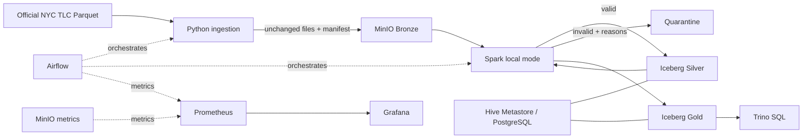

# Architecture

## Phase 0 target design

This is a local, AWS-inspired platform. It does not provision AWS resources. Docker Compose will run the supporting services; Python handles source acquisition and orchestration integration; Spark runs in local mode; Iceberg tables live in MinIO and share a Hive Metastore catalog backed by PostgreSQL. Trino queries the same catalog. Airflow coordinates the work, while Prometheus and Grafana provide operational visibility.

## Resource-aware operation

The inspected host reports 16 logical CPUs, about 11 GiB RAM, and about 938 GiB free on the repository filesystem. The stack should not run every component at once by default. Compose profiles/staged commands should allow the object store, catalog/query services, Airflow, and monitoring to be started only when needed. Spark should begin with conservative local parallelism and memory settings. Two selected source files are approximately 50 MB each, but their decoded processing footprint is larger; keep the initial flow bounded to the selected months.

## Data flow and contracts

Bronze stores the source Parquet byte-for-byte with a separate manifest. Spark reads Bronze through Hadoop S3A, maps known source names into a documented canonical schema, and retains manifest lineage fields. Missing optional columns become typed nulls; known aliases such as `Airport_fee` and `airport_fee` map to one canonical field. Invalid required timestamps, impossible time order, and invalid numeric/domain values are classified into quarantine with reason codes instead of being silently dropped. Valid and rejected records are separate Iceberg tables registered through the shared metastore. Both are partitioned by `source_month`, and month-filtered overwrites make a retry idempotent. See [the data dictionary](data-dictionary.md) and [quality rules](data-quality.md).

The January and February 2024 source schemas inspected in Phase 0 match exactly. That does not remove the need for optional-column handling across other periods.

## Validated Phase 2 compatibility baseline

These are the versions used by the local Compose stack. The Spark–Iceberg–Hive Metastore–MinIO–Trino path passed a write/read interoperability smoke test; this is a local development result, not a production compatibility guarantee.

| Component | Validated baseline | Notes |
|---|---|---|
| Spark | 3.5.3, Java 17, Scala 2.12 | Runs in local mode in the pinned Apache Spark image. |
| Iceberg | 1.6.1 Spark runtime and AWS bundle | Uses `S3FileIO` for MinIO; the smoke job wrote and read a test table. |
| Hive Metastore | Hive 3.1.3, PostgreSQL 16 | Separate PostgreSQL database; JDBC driver is checksum verified. Hadoop AWS 3.1.0 jars let Hive validate Iceberg's `s3://` warehouse paths. |
| Trino | 451 | Iceberg connector uses the same Hive Metastore and native S3 filesystem. |
| MinIO | Digest-pinned community mirror of upstream release | S3 object round trip and Iceberg data path passed. Mirror provenance caveat is documented in the infrastructure notes. |
| Airflow | 3.4.0, Python 3.12, LocalExecutor | Derived image includes pinned PostgreSQL sync/async drivers; LocalExecutor DAG smoke passed. |
| Prometheus / Grafana | Prometheus 3.2.1 / Grafana 11.5.2 | Separate profile; images are pinned by digest and both health endpoints passed. |
| Python tooling | Python 3.12 via `uv`; Ruff and pytest | Host Python 3.14.4 is not required for the project environment. |

## AWS concept mapping

| Local component | AWS concept used for comparison |
|---|---|
| MinIO | Amazon S3 |
| Spark local mode | AWS Glue ETL / Amazon EMR processing concepts |
| Hive Metastore | Glue Data Catalog concept |
| Trino | Athena concept |
| Airflow | MWAA concept |
| Prometheus and Grafana | Monitoring concept similar to CloudWatch |

These are conceptual comparisons, not service equivalences or AWS deployment experience.
